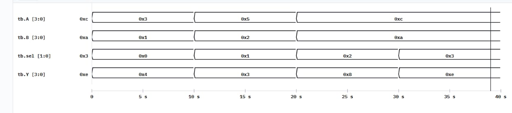
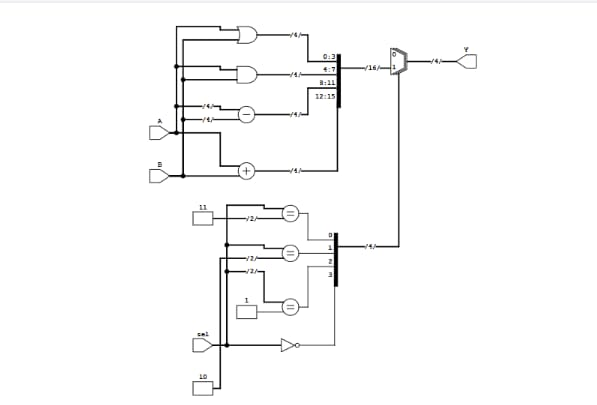

# 4-Bit ALU

## Project Overview

This project implements a 4-bit Arithmetic Logic Unit (ALU) using Verilog HDL.

The ALU performs four basic operations based on the 2-bit select input.

## Operations

| Select | Operation | Description |
|--------|-----------|-------------|
| 00 | Addition | A + B |
| 01 | Subtraction | A - B |
| 10 | AND | A & B |
| 11 | OR | A \| B |

## Inputs

- `A` - 4-bit input
- `B` - 4-bit input
- `sel` - 2-bit operation select

## Output

- `Y` - 4-bit ALU output

## Language

- Verilog HDL

## Tools Used

- VeriSim

## Simulation Results

The ALU was simulated successfully for all four operations.

### Waveform

### RTL Schematic

## Project Files

- `alu.v` - ALU design code
- `alu_tb.v` - Verilog testbench
- `waveform.jpeg` - Simulation waveform
- `rtl_schematic.jpeg` - RTL schematic
